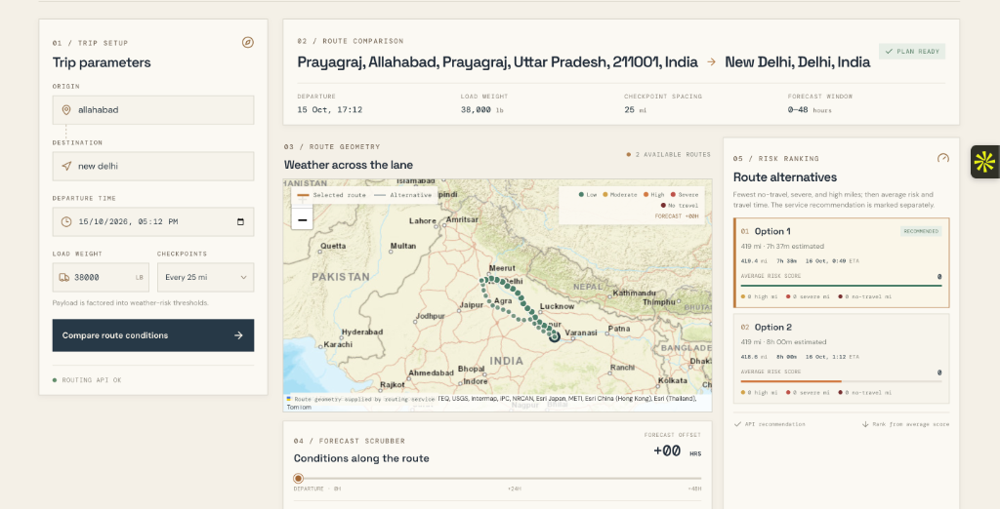
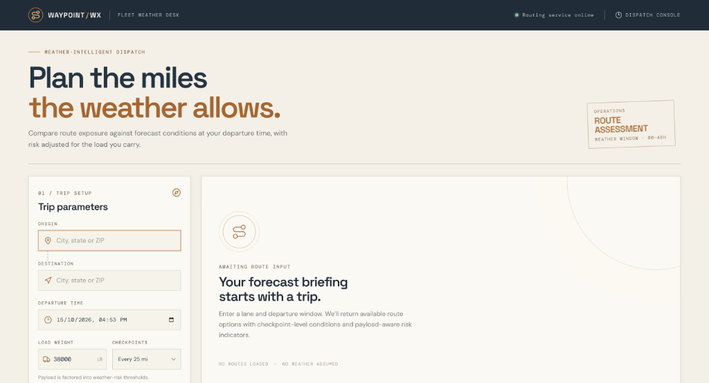
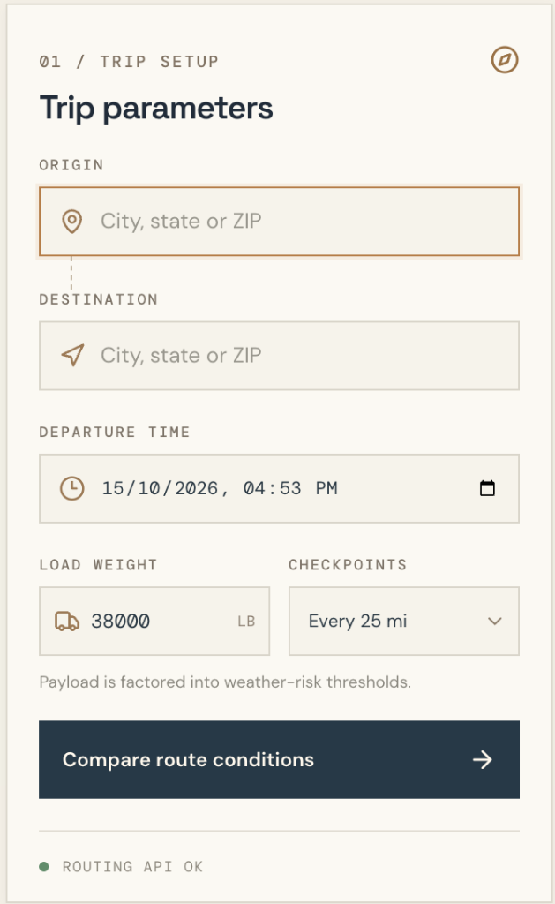
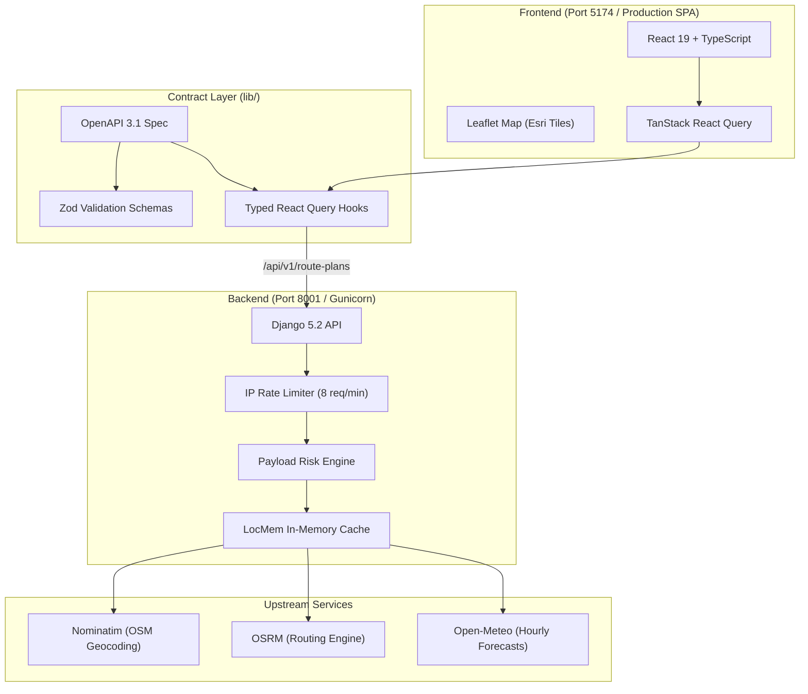

# Weather-Aware Truck Routing

#live link : - https://weather-aware-truck-routing-5yjx.onrender.com/


An intelligent dispatch decision-support platform that evaluates and ranks highway route alternatives using hourly weather forecasts, checkpoint estimated arrival times (ETAs), and payload-specific risk thresholds.

## Interface Previews

### 1. Live Route Analysis & Weather Risk Map
Real-time highway alternatives with risk-coded checkpoint markers, route metrics, and 48-hour forecast scrubber:


### 2. Dispatcher Briefing & Overview
Initial planning workspace before route generation:


### 3. Trip Setup & Payload Configuration
Lane parameters, departure scheduling, cargo weight entry, and checkpoint intervals:

<p align="center">
  
</p>

---

## Key Features

- **Multi-Route Comparison**: Retrieves up to three viable driving alternatives for any origin and destination pair.
- **Dynamic Checkpoint Sampling**: Samples road conditions every 10, 25, or 50 miles along the route.
- **Payload-Aware Risk Assessment**:
  - Automatically scales wind thresholds based on cargo weight (light/empty trailers are flagged for rollover risk at lower wind speeds).
  - Evaluates precipitation and snow intensity against vehicle braking and traction thresholds.
- **Strict Safety-First Ranking**:
  $$\text{No-Travel Miles} \rightarrow \text{Severe Miles} \rightarrow \text{High Miles} \rightarrow \text{Average Risk} \rightarrow \text{Travel Time}$$
- **48-Hour Forecast Scrubber**: Interactive timeline slider lets dispatchers inspect weather progression from departure through +48 hours.
- **Esri World Street Map**: High-contrast, clean logistics basemap with real-time risk-colored checkpoint markers.

---

## Architecture

The system uses a contract-first monorepo design connecting a high-performance React client to a stateless Django REST backend.



### Stack Breakdown

| Layer | Technologies |
| :--- | :--- |
| **Frontend** | React 19, Vite 7, TypeScript, Tailwind CSS, Leaflet, Lucide Icons |
| **API Client** | Auto-generated from OpenAPI 3.1 via Orval, TanStack Query v5 |
| **Backend** | Python 3.13, Django 5.2, Gunicorn 23, WhiteNoise (static serving) |
| **External Providers** | OpenStreetMap Nominatim, OSRM Routing, Open-Meteo Forecasts |
| **Packaging & CI** | Docker multi-stage build, pnpm workspaces, uv |

---

## Concurrency & Performance Model

The application is engineered for high-throughput dispatch operations across four distinct concurrency layers:

1. **Development Concurrency (`concurrently`)**:
   `pnpm run dev` coordinates both the Django Python API and Vite React server simultaneously in a single terminal session, handling synchronized signals, color-coded logging, and automatic exit handling.

2. **Backend Multi-Threading (Gunicorn `gthread`)**:
   In production, Gunicorn operates with multi-threaded worker pools:
   $$\text{Capacity} = 2 \text{ workers} \times 4 \text{ threads} = 8 \text{ concurrent request slots}$$
   Workers asynchronously yield while waiting on external upstream network calls (geocoding, routing, and weather APIs).

3. **Client-Side Async Query Concurrency**:
   TanStack Query executes non-blocking asynchronous data fetching with automatic deduplication, query caching, and optimistic UI transitions.

4. **In-Memory Caching & Rate Limiting**:
   - **Weather Forecast Cache**: 10-minute in-memory caching (`locmem`) prevents redundant forecast calls for overlapping checkpoints.
   - **Geocoding Throttle**: Respects Nominatim's 1-request-per-second policy via thread-safe in-process cache.
   - **Client Guard**: Sliding-window rate limit enforces a maximum of 8 route assessments per minute per IP address.

---

## Quick Start (Local Development)

### Prerequisites
- Node.js `20+` & pnpm `10+`
- Python `3.13+` & uv

### 1. Install Dependencies
```sh
pnpm install
uv sync
```

### 2. Run Application
Start both the backend and frontend concurrently with a single command:
```sh
pnpm run dev
```

| Service | Address |
| :--- | :--- |
| **Frontend (Web UI)** | [http://localhost:5174](http://localhost:5174) |
| **Backend (Django API)** | [http://127.0.0.1:8001/api/v1/health](http://127.0.0.1:8001/api/v1/health) |

*(Vite automatically proxies `/api` requests to port `8001`).*

---

## Testing & Quality

```sh
# Run backend risk engine tests (6 unit tests)
pnpm test

# Run TypeScript typechecks across all packages
pnpm run typecheck

# Build frontend production bundle
pnpm run build
```

---

## Production Deployment

The project is packaged as a unified, multi-stage Docker container where WhiteNoise serves the compiled React assets and Gunicorn handles the API endpoints on a single port (zero CORS required).

### Run with Docker Locally
```sh
docker build -t weather-aware-truck-routing .
docker run -p 8000:8000 -e DJANGO_SECRET_KEY="your-secret-key" weather-aware-truck-routing
```

### 1-Click Deploy to Render
The repository includes [`render.yaml`](render.yaml) for automated Blueprint deployment:
1. Log in to [Render.com](https://render.com) and click **New +** → **Blueprint**.
2. Select repository: `genius-0963/Weather-Aware-Truck-Routing-`.
3. Click **Apply** — Render automatically builds the Docker container and assigns a live HTTPS URL.

---

## API Reference

### Health Check
```http
GET /api/v1/health
```
```json
{
  "status": "ok"
}
```

### Generate Route Plan
```http
POST /api/v1/route-plans
Content-Type: application/json
```
```json
{
  "origin": "Prayagraj, India",
  "destination": "New Delhi, India",
  "departure_at": "2026-10-16T08:00:00Z",
  "load_weight_lb": 38000,
  "sample_interval_miles": 25
}
```

---

## Limitation & Safety Notice

This application provides weather-informed decision support. Routing geometries are generated from general road networks (OSRM) and **do not model bridge heights, gross weight limits, axle restrictions, or hazardous-material bans**. Always verify dispatched routes against official state and national DOT restrictions prior to travel.
